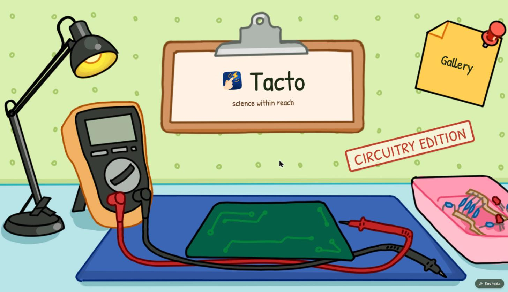
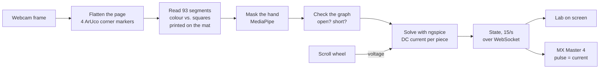

# Tacto: science within reach

**A paper electronics lab where you can feel the current.**

Build a circuit from coloured paper pieces on a printed dot-grid mat. A webcam reads the mat and the same circuit comes alive on screen, solved by a real circuit simulator. Put a finger on any piece and the MX Master 4 mouse pulses with the current flowing through it; turn the scroll wheel to change the battery's voltage. The lab guides you through a short lesson and asks you, out loud, why things happened, adapting its question when your answer misses.

Built at **LauzHack 2026**.



## Why

Hands-on labs are how science clicks, but lab kits cost money and many schools go without. Tacto's kit is a printed sheet, scissors and one laptop with a camera. And it teaches something no simulator app can: you **feel** current in your hand, so voltage (what you push with the wheel) and current (what you feel) stop being the same word.

## The demo, in about a minute

| Step | You do | You see and feel |
|---|---|---|
| 1 | Swap the open (cyan) switch for the closed (green) one | The bulb lights on screen |
| 2 | Touch the bulb on paper, scroll up to 6 V | The pulse speeds up and strengthens; the bulb brightens. The lab asks *why* aloud and listens |
| 3 | Drop a second bulb into the side branch, touch the battery | Two lit branches: the new bulb, behind a 22 Ω resistor, glows dimmer. The battery feeds both, so its pulse is the strongest yet (0.79 A) |

Move, lift or short any piece at any time: the screen follows, and a short circuit buzzes and turns its path orange. Pick up the on-screen **multimeter** and your fingertip becomes its probe: the thumb wheel turns the dial between amps, volts and ohms, and the three numbers always fit V = I × R.

## How it works



1. **See.** Four ArUco markers in the mat's corners give a homography that flattens the page, so the camera can sit at an angle. Every gap between two neighbouring dots (93 of them) is one question: which piece is here? Each is answered by matching its colour against **seven reference squares printed on the mat**, re-read every frame, so the reader calibrates itself to the room's light. No trained model, about 10 ms a frame.
2. **Validate.** Pieces become a graph. Before any physics, networkx finds open circuits and short circuits (and the exact shorted loop), so the simulator only ever sees a circuit with one answer.
3. **Solve.** ngspice computes the DC current through and voltage across every piece in about 1 ms.
4. **Feel.** The piece under the fingertip (MediaPipe hand landmarks, steadied by a One Euro filter) sets the mouse's pulse: 5 pulses a second per amp, stronger with more current, a hard buzz on a short. Driven over WebHID; the mouse connects by itself.
5. **Reflect** (optional). The lab speaks a prewritten question, transcribes the spoken answer (Whisper), and a small model (Qwen3.5-9B) grades it into one of four labels. Code, not the model, decides what happens next; every line the lab says is written by us.

The whole live loop runs on one laptop with the Wi-Fi off. Only the spoken reflections use the network, and the lesson carries on without them.

## Prize tracks

**Logitech: the webcam as the eyes and ears of AI.** The LogiInsight camera reads the whole workspace, MediaPipe hand landmarks turn a fingertip into a probe and the hand into an occlusion mask, the lab listens to spoken answers, and the MX Master 4 becomes a lab instrument: haptics are current, the wheel is voltage, the thumb wheel turns the multimeter's dial. We engineered around the camera itself: manual exposure over UVC, brightness calibrated on the paper, an autofocus kick, and a 5-second setup check.

**IMC Tech for Good.** A science lab for the price of a sheet of paper, for schools and STEM outreach groups that cannot afford kits. The reader needs no training data and calibrates from the mat, the live loop works offline, and the physics is a real simulator, not an animation.

**Scholé AI.** No chat window: you learn by building, touching and predicting. Each step completes from the circuit you built, and when your spoken answer misses, the question narrows (open, then focused, then a choice of two) until the idea lands. The model only grades; it never talks to the learner.

**AXA: frugal multimodal AI.** Camera to circuit with classic image processing, no vision model. Speech to text with Whisper. A one-line description of the circuit plus the answer goes to a 9B model under a JSON schema: about one transcription and one grading call per answer, zero model calls in the live loop. 97% right on 111 student-style answers, with no wrong answer graded right, median 0.34 s.

## Challenges we overcame

- **A component detector that could not read our circuit.** We first tried an off-the-shelf object detector. It called an empty slot an "integrated circuit", a wire a "transformer", found no wires at all, needed the cloud, and returned boxes that, from a webcam looking across the desk, did not line up with the grid. Then we tried markers on every piece and pen-drawn wires, which were too small and exposure-sensitive at that angle. We settled on flat colour pieces read per segment: no parallax, no training, about 10 ms. ([evidence](docs/evidence/detector-experiment/))
- **A camera that fought us.** Auto-exposure burnt out the white paper (0 to 2 of 4 markers found), OpenCV cannot set exposure on macOS, and turning autofocus off parked the lens out of focus. We set exposure over UVC directly, calibrate gain on the paper and then hold it (left adjusting, it swung every 0.4 s on a glare spot and shifted every colour), and restart autofocus when the markers go blurry.
- **Blue wires read as cyan switches.** The camera sees them only about 20 CIELAB units apart, and shadows made it worse. We measure each reference square against the paper next to it and let hue, not brightness, decide the colour: the same wires went from a 52/42 split to 83% right.
- **Hands changing the circuit.** A moving hand made pieces come and go. Now the hand and forearm are masked, held for half a second after they leave, and changes need 8 agreeing frames while a hand is in view.

Every hardware result is logged with numbers in [`docs/hardware-log.md`](docs/hardware-log.md).

## Run it

Needs macOS, [uv](https://docs.astral.sh/uv/), [pnpm](https://pnpm.io/) and ngspice (`brew install libngspice`).

```sh
make setup                 # install everything, build the camera tool
make dev                   # the real lab: camera, mat and mouse, at localhost:5173
make mock & make web       # no hardware: replay a recorded session instead
VOICE_ENABLED=1 make dev   # with spoken reflections (TOGETHER_API_KEY in .env)
```

| Command | What you get |
|---|---|
| `make kit` | The printable mat, `kit/out/mat.pdf`. Print at 100% and check the 50 mm bar |
| Setup check | With `make dev` running, **Dev tools** on the home page (or `localhost:5173/devtools/#setup`): calibrates the camera for the room and checks camera, mat, focus, colours, speed and voice in about 5 s |
| `make bench` | The camera bench: the camera's picture, the flattened mat, each segment's reading |
| `make check` | Format, lint, type-check and tests (577 server tests) |

### Before a demo

1. Print the mat and the pieces at 100% (`kit/printed/`), and lay out a circuit.
2. Start the lab, open `localhost:5173`, and allow the mouse once in Chrome (**Dev tools → Haptics → Allow the mouse**). After that it connects by itself.
3. With hands off the mat, run the **setup check**. It calibrates the camera for the room and holds that setting.
4. Click the circuit board, then **Lab**.

## Built with

Python 3.12, FastAPI, pydantic, OpenCV, MediaPipe, networkx, ngspice (InSpice) · React 19, TypeScript, Vite, Tailwind, WebHID · Together AI: Whisper large v3, Qwen3.5-9B, Kokoro-82M · Logitech LogiInsight camera and MX Master 4.

## Repository

| Path | What it is |
|---|---|
| `server/tacto/vision/` | The camera reader: flatten, read segments, hand mask, smoothing, camera control |
| `server/tacto/sim/` | Graph checks, the ngspice solver, current to pulse |
| `server/tacto/lab.py`, `lesson.py`, `funnel.py` | The lab loop, the lesson and the reflection state machines |
| `server/tacto/grader.py`, `tts.py`, `listen.py` | Voice: grading, cached speech, spoken answers |
| `web/src/` | The lab UI: bench, notebook, haptics, voice |
| `contract/` | The state message schema shared by server and UI, with a recorded sample |
| `lessons/` | Lessons as YAML, and the grader's test answers |
| `kit/` | The printable mat and piece colours |
| `docs/` | [Architecture](docs/architecture.md), [tech stack](docs/tech-stack.md), [demo lesson](docs/lab-flow.md), [voice plan](docs/voice-reflections-plan.md), [hardware log](docs/hardware-log.md), [roadmap](docs/roadmap.md) |
