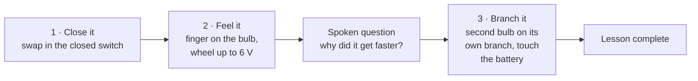
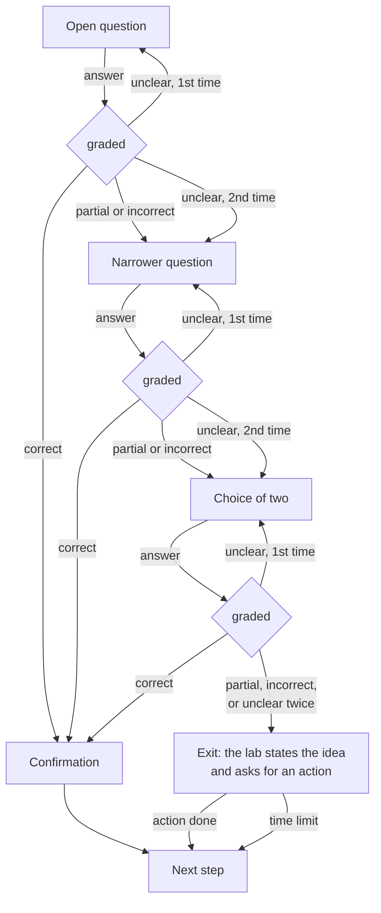

# The lab, step by step

> **Status: approved by Katie and built on 22 Nov 2026.** The lab runs this lesson (`lessons/circuits-101.yaml`). The full six-step lesson is kept as `lessons/circuits-101-full.yaml`. Not yet run on the real mat.

The current six-step lesson takes about three minutes on its own, and up to five if the learner struggles. The demo needs the key features shown in about **one minute of hands-on time**, inside a three-minute pitch.

## Contents

1. [What the demo has to show](#1-what-the-demo-has-to-show)
2. [The short lab at a glance](#2-the-short-lab-at-a-glance)
3. [Before the judge sits down](#3-before-the-judge-sits-down)
4. [The three steps](#4-the-three-steps)
5. [The one spoken question](#5-the-one-spoken-question)
6. [Timing](#6-timing)
7. [What changes from today](#7-what-changes-from-today)
8. [Reference: how a reflection runs](#8-reference-how-a-reflection-runs)
9. [Reference: voice, mouse, and when things go wrong](#9-reference-voice-mouse-and-when-things-go-wrong)
10. [Questions for you](#10-questions-for-you)

---

## 1. What the demo has to show

| Feature we built | Where the judge sees it |
|---|---|
| The camera reads paper pieces, and the screen copies the mat live | Every step |
| A switch is two pieces: swap one for the other and the circuit changes | Step 1 |
| The pulse in the mouse **is the current**, felt with a fingertip on the paper | Steps 2 and 3 |
| The scroll wheel **is the voltage**: faster and stronger pulse, brighter LED, volts tag on the battery | Step 2 |
| The lab asks out loud, hears the answer, grades it, and narrows the question if it misses | After step 2 |
| Parallel branches: currents add at the battery, the strongest pulse in the demo; the branch with the resistor glows dimmer | Step 3 |
| The notebook, the handwriting, the voice | Throughout |

Left out, to save time:

- **Two bulbs in series:** it shows the same idea as step 2 (less current, slower pulse) and costs 30 seconds and a second spoken question.
- **A short circuit:** cut by Katie on 22 Nov ("I don't need to show that"). The lab still detects and buzzes on a short if one happens.

---

## 2. The short lab at a glance

---

## 3. Before the judge sits down

The presenter lays this out on the mat, so the judge only ever changes one thing at a time:

- **A loop:** battery, one bulb and wires, with the **open (cyan) switch already in it**.
- **A side branch** beside the bulb with a gap where the second bulb goes: a **resistor** from (2,1) to (2,2) and a wire from (3,1) to (3,2). The resistor makes the second bulb glow dimmer than the first, and gives the meter a resistor to read.
- **Within reach:** the closed (green) switch and the second bulb.
- **Mouse connected,** lab opened from the circuit board, then **Lab** pressed: the lesson starts at step 1 and **3 V**.

---

## 4. The three steps

Each step is finished when its goal has held for half a second, then shows **✓ Done**. Steps without a question move on after **2.5 s** (was 6 s).

| # | Notebook says | Finished when | The judge sees and feels |
|---|---|---|---|
| 1 | *Close the circuit: swap in the green switch.* | Circuit working, the bulb lit, the switch closed | The bulb lights on screen (dim, 0.3 A) and the battery lights up |
| 2 | *Touch the bulb to feel the pulse, then scroll up to 6 V.* | Finger on the bulb, 6 V or more | The pulse speeds up and strengthens, the LED turns bright, the tag counts up to 6.0 V |
| | *(spoken question, section 5)* | | |
| 3 | *Drop the second bulb into the gap, then touch the battery.* | Two bulbs lit in parallel, finger on the battery | The second bulb glows dimmer (0.3 A, behind the resistor); the battery gives the strongest pulse of the demo (0.9 A, 4.5 a second) |

After step 3: **✓ Lesson complete** with *"Lab complete! Turning up the voltage pushed more current through the bulb. Adding a second bulb on its own branch meant the battery had to carry the current for both at once, which is why it pulsed the strongest."*

---

## 5. The one spoken question

Only step 2 has a reflection. It keeps the full funnel, so the adaptive part can still be shown. The presenter can steer it: a right answer moves on at once, and one deliberate miss shows the narrower question.

| | Line |
|---|---|
| Opens with | *Why did the pulse speed up when you turned up the voltage?* |
| After a miss | *Here's a hint: the pulse is the current. What does more voltage do to the current?* |
| After a second miss | *So does more voltage mean more current, or less?* |
| Right answer | *Exactly. More voltage pushes more current through the bulb, and that's what you feel.* |
| After three misses | *More voltage pushes more current, and the pulse is the current. Scroll down and feel it slow, then back up to 6.* |

- The narrower questions and both closing lines are **shortened** from today's (each 1 to 3 seconds quicker to say).
- The exit still asks for 3 V then 6 V, so step 3 runs at the right current.
- The exit gives up after **12 s** (was 20 s), counted from when its line has been said.

The series and parallel questions stay in `lessons/circuits-101-full.yaml` and are not used.

Grader on these exact questions: 36 of 37 test answers right, no wrong answer graded right (`scripts/grade_fixtures.py --lesson circuits-101`).

---

## 6. Timing

| Moment | Quick judge | Judge who misses once |
|---|---|---|
| Step 1 | 8 s | 8 s |
| Step 2 | 12 s | 12 s |
| Spoken question | 10 s | 20 s |
| Step 3 | 20 s | 20 s |
| Pauses between steps | 5 s | 5 s |
| **Total hands-on** | **about 55 s** | **about 65 s** |

Worst case (three misses and the exit): about 90 s.

---

## 7. What changed from the six-step lesson

| | Six-step lesson | Short demo |
|---|---|---|
| Steps | 6 | 3 |
| Starting layout | Loop with a gap | Loop with the open switch already in |
| Spoken questions | 3 (steps 4, 5, 6) | 1 (step 2) |
| Series step | Yes | Dropped |
| Pause after a step | 6 s | 2.5 s |
| Exit time limit | 20 s from the start of the exit | 12 s from when its line has been said |
| Closing line | *Same two bulbs, different connections…* | *Lab complete! Turning up the voltage pushed more current…* |

Changes made (22 Nov 2026):

1. **`lessons/circuits-101.yaml`:** the three steps, the shorter lines, `linger_seconds: 2.5`, exit `timeout_seconds: 12`.
2. **The exit timer** starts once its line has been said (`server/tacto/lesson.py`).
3. **The closing line** in the notebook (`web/src/ui/LessonStrip.tsx`).
4. **The new spoken lines** are recorded (4 new; the exit line is now 6.8 s, was 9.4 s).
5. **Tests:** `server/tests/test_short_lesson.py` walks the three steps; the engine's own tests run on the full lesson.
6. **Still to do: test on the real mat,** with Katie.

---

## 8. Reference: how a reflection runs

The language model only **grades** an answer into one of four labels; the code decides what happens next, and every line the lab says is written in the lesson file.

| Label | Means | Example | What happens |
|---|---|---|---|
| **correct** | Gives the idea, in any words | *"more push so more flow"* | Confirmation, then the next step |
| **partial** | On topic but not there yet, or "I don't know" | *"because there's more voltage"* | One question narrower |
| **incorrect** | Physically wrong, or a known misconception | *"the pulse is the voltage"* | One question narrower |
| **unclear** | Not an answer: silence, "what?", off topic | *"can you repeat that"* | The same question again, once |

**Skip** ends a reflection at any point; **Restart lab** (or R) goes back to step 1 at 3 V.

---

## 9. Reference: voice, mouse, and when things go wrong

### Voice

- **Answer by voice** turns the microphone on for the browser session. It opens only after the lab has finished its line, and closes when the answer ends or after 15 s.
- **Hold Space** to talk in a noisy room. The **answer box** is always there to type instead.
- The heading shows **Listening…** and **Thinking…**, then the notebook shows *You said: …*
- The voice is Kokoro `af_nova`. Only the words of graded answers are kept, on this laptop; the sound is not.

### What the mouse plays (at 6 V)

| Finger on | Current | Pulse | Strength |
|---|---|---|---|
| One bulb, or a wire in its loop | 0.6 A | 3 a second | 50% |
| The first bulb, with the second branch in | 0.6 A | 3 a second | 50% |
| The second bulb or the resistor (its branch) | 0.3 A | 1.5 a second | 25% |
| The battery with both branches | 0.9 A | 4.5 a second | 75% |
| Anything in an open loop | 0 | silent | |
| A shorted piece | | continuous buzz | 100% |

At 3 V every current halves. The LED is **dim** below about 0.42 A and **bright** above it; the battery lights only while current flows.

### When things go wrong

| Situation | What happens |
|---|---|
| A hand or arm over the mat | Pieces under it keep their last reading |
| Corners covered, or the picture soft | The mat's position is held for up to 10 s; autofocus is kicked after 2 s |
| The camera unplugged | The mat shows "not found" and holds its pieces. The lab must be restarted after replugging (today) |
| Grading slow or failing | After 4.5 s the answer counts as partial: one question narrower |
| Network lost | Every answer counts as partial; the exit's time limit moves the lesson on |
| No sound | The line is shown; the lesson waits 3 s instead of for the sound |

---

## 10. Questions for you

- [ ] **One spoken question, or two?** (Built with one.) A second one after step 3 (*"Why is the pulse faster at the battery than at either bulb?"*) shows the grading on a harder idea, for about 15 more seconds.
- [ ] **Drop series entirely,** or keep it as a spare the presenter can run in Tinker mode if asked?
- [ ] **Starting voltage 3 V?** (Built at 3 V.) It makes step 2's change bigger; starting at 6 V would skip the wheel.
- [ ] **Reconnect the camera automatically** after an unplug, so a bumped cable at the demo needs no restart?
