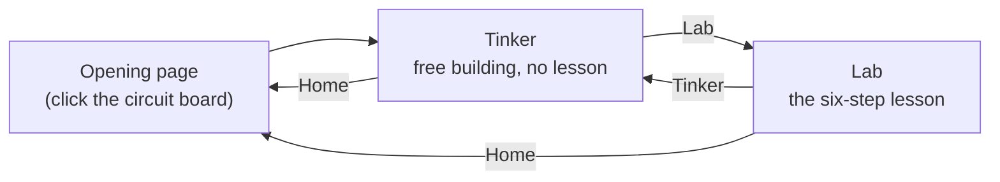
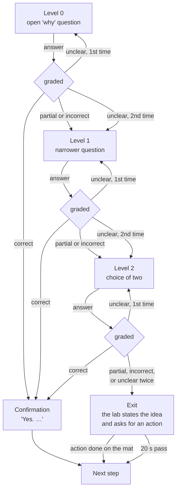
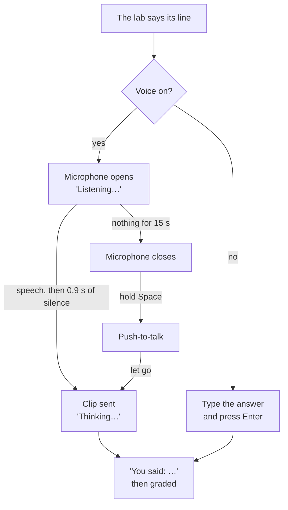

# The lab, step by step

Every screen, instruction and decision point in the Tacto lab, as the code runs it on 22 Nov 2026. Read it top to bottom to review the flow; the last section lists what still looks wrong.

> **Where the words come from.** Step prompts and every spoken line live in `lessons/circuits-101.yaml`. Change the wording there; no code change is needed. Timings live in the code files named beside them.

## Contents

1. [Screens and buttons](#1-screens-and-buttons)
2. [Before a run](#2-before-a-run)
3. [The six steps](#3-the-six-steps)
4. [How a reflection runs](#4-how-a-reflection-runs)
5. [The three reflections, word for word](#5-the-three-reflections-word-for-word)
6. [Answering by voice](#6-answering-by-voice)
7. [What the mouse plays](#7-what-the-mouse-plays)
8. [When things go wrong](#8-when-things-go-wrong)
9. [Open questions for review](#9-open-questions-for-review)

---

## 1. Screens and buttons

| Control | Where | What it does |
|---|---|---|
| **Home** | Top left | Back to the opening page. The lab keeps its place |
| **Tinker / Lab** | Top left | Tinker: build freely, touch to feel, no prompts. Lab: starts the lesson at **step 1 and 3 V** every time it is chosen |
| **Restart lab** (or **R**) | Bottom right of the notebook | Back to step 1 and 3 V. The pieces have to be put back by hand |
| **Skip** | In a reflection | Ends the reflection and moves to the next step |
| **Answer by voice** | In a reflection | Turns the microphone on for the rest of the browser session |
| **Connect mouse** | Bottom right | Pairs the MX Master 4 for the vibration |
| Scroll wheel | Anywhere | Battery voltage, 0 to 9 V in 0.5 V steps |

---

## 2. Before a run

The step prompts assume the presenter has already laid out:

- a loop of **battery, one bulb and wires** with **one gap** where the switch goes,
- an **empty side branch** for step 6,
- the **open (cyan)** and **closed (green)** switch pieces and a **second bulb** within reach.

With voice on (`VOICE_ENABLED=1 make dev`), steps 4 to 6 end in a spoken exchange. With voice off, each of those ends in one question on screen and a **Continue** button (or Enter).

---

## 3. The six steps

A step is finished when its goal has held for **0.5 s** with the mat in view (`SETTLE_SECONDS`, `lesson.py`). It then shows **✓ Done** and stays done even if the mat changes.

| # | Notebook says | Finished when | The learner feels | Then |
|---|---|---|---|---|
| 1 | *Place the open switch in the gap. Does the bulb light?* | Circuit open; 1 battery, 1 bulb; the switch is the open piece | Nothing; the bulb stays dark | 6 s pause, next step |
| 2 | *Swap in the closed switch. Watch the bulb.* | Circuit working; 1 bulb lit; the switch is the closed piece | Nothing yet; the bulb lights on screen | 6 s pause |
| 3 | *Rest a finger on the bulb card. Feel the pulse in the mouse.* | Fingertip on the lit bulb | 0.3 A: slow and faint | 6 s pause |
| 4 | *Keep your finger there. Turn the wheel up to 6 V.* | Fingertip on the bulb and the battery at 6 V or more | 0.6 A: twice as fast, stronger | **Reflection: voltage** |
| 5 | *Replace the bottom wire with a second bulb. Touch the first bulb again.* | Two bulbs lit in series; fingertip on a bulb | 0.3 A: slow and faint again | **Reflection: series** |
| 6 | *Move the second bulb to its own branch and restore the bottom wire. Touch a bulb, then the battery.* | Two bulbs lit in parallel; fingertip on the battery | Bulb 0.6 A; battery 1.2 A, fastest and full strength | **Reflection: parallel** |

After step 6 the notebook shows **✓ Lesson complete** and *"Same two bulbs, different connections, and a difference you can feel."*

> **Note:** the 6 s pause after steps 1 to 3 (`linger_seconds` in the lesson file) is meant for the presenter to talk. Nothing is spoken in those steps.

---

## 4. How a reflection runs

Every reflection follows the same rules (`server/tacto/funnel.py`). The language model only **grades** an answer into one of four labels; the code decides what happens next, and every line the lab says is written in the lesson file.

### The four labels

| Label | Means | Example (step 4, level 0) | What happens |
|---|---|---|---|
| **correct** | Gives the idea, in any words | *"more push so more flow"* | Confirmation, then the next step |
| **partial** | On topic but not there yet, or "I don't know" | *"because there's more voltage"* | One level narrower |
| **incorrect** | Physically wrong, or a known misconception | *"the pulse is the voltage"* | One level narrower |
| **unclear** | Not an answer: silence, "what?", off topic, a bare "yes" | *"can you repeat that"* | The same question again, once. A second time counts as partial |

### Timing

| Moment | How long | Set in |
|---|---|---|
| Confirmation stays up | Until its audio ends, plus 0.6 s, but never less than 3 s and never more than 12 s | `CONFIRM_SECONDS`, `AFTER_HEARD_SECONDS`, `CONFIRM_MAX_SECONDS` in `lesson.py` |
| Exit: goals start to count | Once the exit line has been said (or after 3 s if there is no audio) | `lesson.py` |
| Exit: each goal must hold | 0.5 s | `SETTLE_SECONDS` |
| Exit: gives up | 20 s after the exit begins, counting the time it takes to say the line | `timeout_seconds` in the lesson file |
| Grading an answer | 4.5 s at most, then it counts as partial | `GRADE_DEADLINE_S` in `lab.py` |

### Limits that always hold

- At most **three graded answers** per reflection; with the two possible repeats, at most six answers.
- A reflection **cannot loop**: it always ends at a confirmation, at the exit's action, or at the 20 s limit.
- **Skip** ends it at any point. **Restart lab** clears it.

---

## 5. The three reflections, word for word

Seconds in brackets are how long the line takes to say in the `af_nova` voice.

### Step 4: voltage

**Target idea:** a higher voltage pushes more current through the bulb, and the pulse is the current.

| | Line |
|---|---|
| Level 0 (3.0 s) | *Why did the pulse get faster when you raised the voltage?* |
| Level 1 (5.1 s) | *The pulse is the current through the bulb. What does the battery's voltage do to that current?* |
| Level 2 (3.5 s) | *Does a higher voltage push more current round the loop, or less?* |
| Confirmation (4.9 s) | *Yes. More voltage pushes more current through the bulb, and the pulse is that current.* |
| Exit (9.4 s) | *A higher voltage pushes more current through the bulb, and the pulse is that current. Turn the wheel down to 3 volts and feel it slow, then back up to 6.* |

- **Exit goals, in order:** finger on the bulb at **3 V or less**, then finger on the bulb at **6 V or more**.
- **Misconceptions tagged:** `pulse_is_voltage` (thinks the pulse is the voltage itself) and `brightness_only` (only says the bulb got brighter).

### Step 5: two bulbs in series

**Target idea:** two bulbs in a row resist more, so the same battery drives less current.

| | Line |
|---|---|
| Level 0 (2.9 s) | *Why did adding a second bulb make the pulse slower?* |
| Level 1 (6.8 s) | *The current now has to go through both bulbs, one after the other. Is that easier or harder than going through one?* |
| Level 2 (4.0 s) | *With two bulbs in a row, is the total resistance bigger or smaller?* |
| Confirmation (4.9 s) | *Yes. Two bulbs in a row resist more, so the same battery pushes less current.* |
| Exit (7.6 s) | *Two bulbs in a row resist more, so the same battery pushes less current. Touch the other bulb: the pulse is the same there.* |

- **Exit goal:** finger on a bulb **other than** the one touched when step 5 finished.
- **Misconceptions tagged:** `current_used_up` (the first bulb uses some current up) and `current_shared` (the battery gives a fixed current the bulbs split).

### Step 6: two bulbs in parallel

**Target idea:** each branch carries its own current and the battery supplies both, so the currents add at the battery.

| | Line |
|---|---|
| Level 0 (3.3 s) | *Why is the pulse faster at the battery than at either bulb?* |
| Level 1 (4.4 s) | *Each bulb has its own path back to the battery. Where do the two currents meet?* |
| Level 2 (4.1 s) | *Is the current at the battery one bulb's current, or both added together?* |
| Confirmation (5.8 s) | *Yes. The battery feeds both branches, so its current is the two bulb currents added together.* |
| Exit (8.1 s) | *The battery feeds both branches, so its current is the two bulb currents added together. Touch one bulb, then the battery, once more.* |

- **Exit goals, in order:** finger on **a bulb**, then finger on **the battery**.
- **Misconceptions tagged:** `battery_is_stronger` (the battery is the source so it is just stronger) and `same_as_series` (expects the same current everywhere).

---

## 6. Answering by voice

Only in a reflection, and only after **Answer by voice** has been clicked once in this browser session.

- **Half duplex:** the microphone never opens while the lab is speaking.
- **Push-to-talk:** hold **Space**, speak, let go. Works everywhere except while typing in the answer box.
- **The text box is always there** as the fallback.
- **Nothing heard:** an empty clip counts as *unclear*, so the question is asked again.
- **Microphone blocked by the browser:** a red message says so, and typing still works.
- **What is kept:** the words of each graded answer, with its label, in `server/data/answers-<start time>.jsonl` on this laptop (never committed). The sound is never kept.

---

## 7. What the mouse plays

The vibration is the **current** through the piece under the fingertip; the wheel is the **voltage**. Rate and strength both rise with the current (`server/tacto/sim/feel.py`).

| Finger on, at 6 V | Current | Ticks a second | Strength |
|---|---|---|---|
| One bulb, or any wire in its loop | 0.6 A | 3 | 50% |
| One of two bulbs in series | 0.3 A | 1.5 | 25% |
| One of two bulbs in parallel | 0.6 A | 3 | 50% |
| The battery with two in parallel | 1.2 A | 6 (the cap) | 100% |
| Anything in an open circuit | 0 | silent | |
| A shorted piece | | a continuous buzz | 100% |

At 3 V every current halves. Strength runs from 25% to 100% of the mouse's own range (`MIN_STRENGTH_PERCENT`, `web/src/haptics/strength.ts`), so even the faintest current is felt.

---

## 8. When things go wrong

| Situation | What happens |
|---|---|
| A hand or arm over the mat | Pieces under it keep their last reading; changes elsewhere need 8 agreeing frames instead of 3 |
| Some corner markers covered | The mat's position is held while the visible corners agree |
| No corner readable (focus lost) | Pieces freeze for up to 10 s; autofocus is kicked after 2 s |
| Mat not found at all | "Mat not found": pieces held, nothing changes |
| A piece the camera cannot decide | Its last reading is kept |
| Grading slow or failing | After 4.5 s the answer counts as partial: one level narrower |
| Network lost mid-reflection | Every answer counts as partial, the exit is reached, and its 20 s limit moves the lesson on. No restart needed |
| No spoken audio for a line | The line is only shown; the lesson waits 3 s instead of for the sound |
| Voice off | Reflections are one question and **Continue**, as before |

---

## 9. Open questions for review

These came out of the walk-through and the code review. None is fixed yet.

- [ ] **A judge can't start alone.** Steps 1, 5 and 6 refer to "the gap", "the bottom wire" and "its own branch", and nothing on screen describes the starting layout. *Suggestion:* step 1 says *"Build a loop with the battery, a bulb and wires. Leave one gap and put the open switch in it."*
- [ ] **Step 6 never checks the bulb touch.** It finishes on the battery alone, but its question compares the battery with a bulb. *Suggestion:* require a bulb, then the battery, in order.
- [ ] **Step 4's exit is tight.** The line takes 9.4 s of the 20 s, leaving about 10 s to turn down to 3 V and back up to 6 V. If time runs out halfway, steps 5 and 6 run at 3 V. *Suggestion:* start the 20 s once the line has been said.
- [ ] **Step 5 says "the first bulb"** but any bulb counts. *Suggestion:* "Touch a bulb again."
- [ ] **The lab only speaks in steps 4 to 6.** *Option:* speak all six prompts too.
- [ ] **Pacing.** A learner who misses everything spends up to about 50 s per reflection, about 2.5 minutes for all three.
- [ ] **The resistor is never used** in the lesson, and one left in the loop lowers every current above.
- [ ] **Very short spoken answers** ("more", "both") can be missed under push-to-talk.
