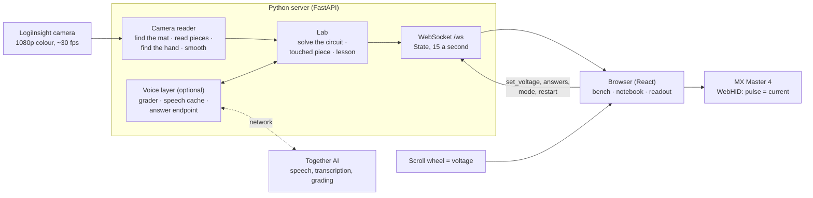
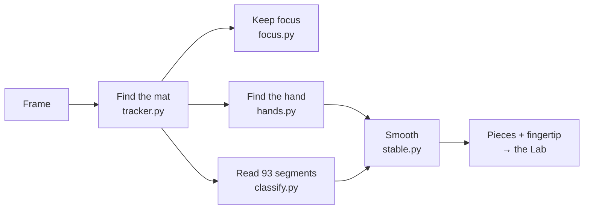
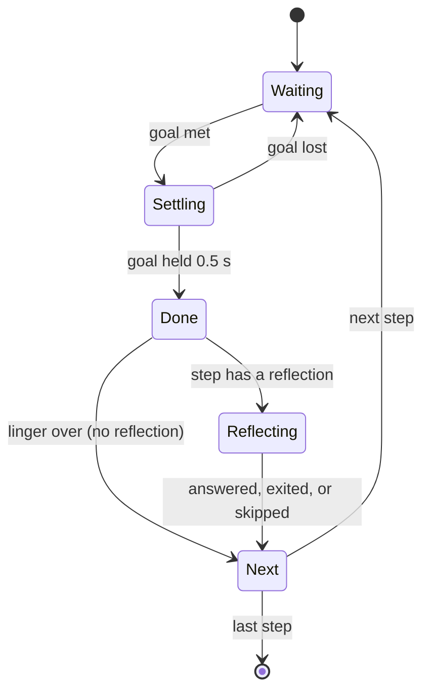
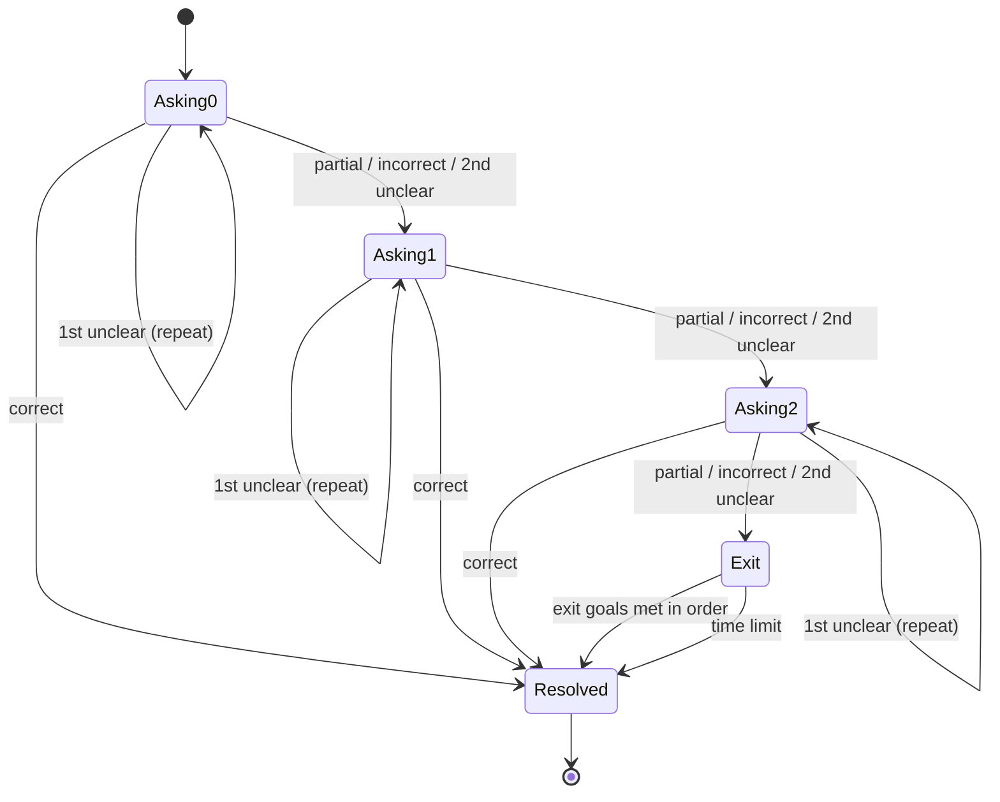

# Tacto: technical deep dive

How every part of Tacto works, why it was built that way, and the numbers behind it. Written to review the implementation and to answer any technical question about it. Accurate as of 22 Nov 2026 (`main`).

## Contents

1. [The system in one picture](#1-the-system-in-one-picture)
2. [Tech stack](#2-tech-stack)
3. [The camera pipeline](#3-the-camera-pipeline)
4. [From pieces to physics](#4-from-pieces-to-physics)
5. [Touch and the mouse](#5-touch-and-the-mouse)
6. [The lesson as a state machine](#6-the-lesson-as-a-state-machine)
7. [Voice reflections](#7-voice-reflections)
8. [The state contract](#8-the-state-contract)
9. [The web app](#9-the-web-app)
10. [All the state machines](#10-all-the-state-machines)
11. [Measured numbers](#11-measured-numbers)
12. [Testing](#12-testing)
13. [Failure modes and fallbacks](#13-failure-modes-and-fallbacks)
14. [Design decisions and the reasons for them](#14-design-decisions-and-the-reasons-for-them)
15. [Questions a judge might ask](#15-questions-a-judge-might-ask)
16. [Where to find things](#16-where-to-find-things)

---

## 1. The system in one picture

One Python server on one laptop turns camera frames into a **state message**, about 15 times a second. The browser draws that state and drives the mouse. Everything in this loop runs locally; only the optional voice layer uses the network.

**The physics rule that runs through everything:** the vibration in the mouse is **current** (amps); the scroll wheel is **voltage** (volts). The two are never mixed in code, names or wording.

---

## 2. Tech stack

### Server (Python 3.12, managed with `uv`)

| Job | Library | Why this one |
|---|---|---|
| Web server, WebSocket | **FastAPI** + **uvicorn** | One process serves the state stream, the camera preview, the voice routes and debug pages |
| Message models, validation | **pydantic v2** | The contract is pydantic models; JSON schemas for the UI team are generated from them |
| Camera capture, marker finding, image maths | **OpenCV** (`cv2`, `cv2.aruco`) and **numpy** | ArUco markers, homography, colour conversion, all in one well-known library |
| Fingertip and hand tracking | **MediaPipe Hand Landmarker** (Apache-2.0) | 21 hand points a frame from our own colour frames, about 25 ms, no extra hardware |
| Circuit graph: open, short, which path | **networkx** | Connectivity and shortest paths, so a short or an open loop is found before any solving |
| Circuit physics | **ngspice** through **InSpice** | A real SPICE engine gives the DC operating point, so currents and voltages are exact, not hand-approximated |
| Camera exposure and focus | **uvc-util** (MIT, built by `make camera-tool`) | OpenCV cannot set exposure on macOS; uvc-util speaks the camera's UVC controls directly |
| Lesson and mat files | **PyYAML** | Lesson wording and mat geometry are data, edited without touching code |
| Calls to Together AI | **httpx** | Plain HTTPS with strict timeouts; no SDK, no agent framework |
| Settings and the API key | **python-dotenv** | The key lives in a gitignored `.env`, never in the browser or the repo |
| Tooling | **ruff**, **pytest** | `make check` must pass before every commit |

### Web (TypeScript, managed with `pnpm`)

| Job | Library |
|---|---|
| Build and dev server | **Vite** |
| UI | **React 19**, **Tailwind CSS v4** |
| One store for the server's state | **zustand** |
| Animation | **motion**, CSS |
| Fonts, bundled to work offline | **Space Grotesk** (UI), **Patrick Hand** (the notebook and top bar) |
| Voice detection in the browser | **@ricky0123/vad-web** (Silero VAD on `onnxruntime-web`), files served from the laptop |
| Screenshot gallery storage | **idb-keyval** (IndexedDB) |
| Mouse vibration | **WebHID** to the MX Master 4 through the Logi Bolt receiver (HID++ haptic feature `0x19b0`, 15 preset waveforms) |

### Hosted models (Together AI, voice layer only)

| Job | Model | Measured |
|---|---|---|
| The lab's spoken lines | `hexgrad/Kokoro-82M`, voice `af_nova` | 0.2 to 0.7 s a line, cached on disk at startup |
| Transcribing the learner | `openai/whisper-large-v3` | about 0.5 s a clip |
| Grading the answer | `Qwen/Qwen3.5-9B`, reasoning off, JSON schema, temperature 0 | median 0.34 s |

Model names live in one file, `server/tacto/voice_models.py`, chosen from the account's live model list, not from memory. `scripts/together_smoke.py` checks all three calls.

### Hardware

| Device | Role |
|---|---|
| **LogiInsight webcam** (`LVNext`, Mac RGB stream) | The only camera; colour 1080p, about 30 fps. No infrared on this unit |
| **MX Master 4** via the **Logi Bolt** receiver | Haptic pulse (current) and scroll wheel (voltage) |
| **Printed A4 mat** | 9 × 6 dot grid, 28 mm apart, four ArUco corner markers, seven reference colour squares |
| **Printed pieces** | Wire (blue), bulb (yellow), resistor (magenta), switch closed (green), switch open (cyan), battery (red + and black −) |

---

## 3. The camera pipeline

Every frame goes through the same steps, on one reader thread (`server/tacto/vision/source.py`).

### 3.1 Exposure and focus

- **Exposure is set to manual** (`vision/exposure.py`). On auto, the camera exposes for the dark background, the white paper clips and the markers vanish. Manual at gain 0 fixed it: from 0 to 2 markers read, to all 4.
- **Focus cannot be locked**: this camera has no focus distance, and turning autofocus off parks the lens out of focus. Instead a **focus kicker** watches for frames where no corner can be read and restarts autofocus (off, one second, on). That is a small state machine; see [section 10](#10-all-the-state-machines).

### 3.2 Finding the mat

- The mat has **four ArUco markers** (dictionary `4X4_50`, ids 0 to 3, 20 mm) at its corners.
- When all four are seen, a **homography** maps camera pixels to page millimetres, and the frame is warped to a square-on picture of the page at 100 dpi.
- **Holding the position** (`vision/tracker.py`): a hand usually covers a corner. The tracker keeps the last four-corner homography as long as the corners still visible are within **4 mm** of where it predicts them. With no corner visible it holds for up to **10 s**, but marks the frame **unconfirmed**, and nothing is read off an unconfirmed frame (it may be blurred).

### 3.3 Reading the pieces

- The mat is a grid of **segments**: every gap between two neighbouring dots (93 on a 9 × 6 grid). A piece always lies on one segment, so reading the mat is **93 small classifications**, not object detection.
- For each segment a fixed-size **patch** is cut from its middle (`vision/patches.py`).
- **Colour, matched to the mat's own reference squares** (`vision/classify.py`):
  - The page is divided by the **paper's colour**, so white paper reads white under any light, then converted to **CIELAB**.
  - The seven printed squares on the mat are sampled **every frame**, each against the paper right around it, so a shadow over the squares cancels out.
  - Each pixel goes to the nearest square. Whether a pixel is a piece colour at all is judged by plain colour distance (so skin is not a piece); which piece is judged mostly by **hue**, which shadow and glare leave alone. That fixed blue wires being misread as cyan open switches.
  - A patch is a piece when enough of it (35%) is that piece's colour; between 18% and 35% it is **unsure**.
  - **Battery:** red beside black is a battery, and the **red end is positive**, so polarity is read from the piece.
  - **Empty** is only declared when flat, bare paper shows. Cloth and skin are uneven, so an arm over a segment reads **unsure**, not empty.
- No trained model: the reference squares made one unnecessary, and the reader needs no training data.

### 3.4 Smoothing and the hand

- **Smoothing** (`vision/stable.py`): a segment's reading changes only after **3 frames agree** (8 while a hand is about). An **unsure** reading never changes anything.
- **The hand** (`vision/hands.py`, MediaPipe): 21 joints per hand, mapped onto the page through the same homography.
  - **The index fingertip** becomes the touch position.
  - **The hand and forearm** become a mask: the hull round the joints plus 14 mm, and the forearm running 400 mm back from the wrist. Segments under it **keep their last reading**, and keep it for **0.5 s** after the hand is last seen, so a hand moving over the mat cannot change the circuit.

---

## 4. From pieces to physics

`server/tacto/pieces.py` and `server/tacto/sim/`.

1. **Graph first** (`sim/graph.py`, networkx): dots are nodes, pieces are edges. Before any solving, the graph answers:
   - **Open:** no closed loop through the battery.
   - **Shorted:** a loop through the battery with nothing in it to resist, plus the **path** of that loop.
2. **Then SPICE** (`sim/solver.py`): only a circuit with a unique answer reaches ngspice. Bulbs and resistors are **10 Ω**, wires and closed switches **0.001 Ω**, and the battery is the voltage the wheel set. ngspice returns the **current through and voltage across** every piece.
3. **Brightness** is the bulb's power over 3.6 W (one bulb at 6 V is 1.0).
4. Solving runs only when the pieces or the voltage change: about **1 ms**, after a 0.4 s warm-up at startup.

| Circuit at 6 V | Current at the battery | Each bulb |
|---|---|---|
| One bulb | 0.6 A | 0.6 A |
| Two in series | 0.3 A | 0.3 A |
| Two in parallel | 1.2 A | 0.6 A |

---

## 5. Touch and the mouse

- **The touched piece** is the one nearest the fingertip, within 0.35 of a dot spacing (`lab.py`).
- **What the mouse plays** (`sim/feel.py`), both proportional to the current through that piece:
  - **Rate:** 5 ticks a second per amp (0.6 A is 3 a second).
  - **Strength:** current over 1.2 A, from 0 to 1.
  - Below 5 mA: silent. On a shorted piece: a continuous buzz.
- **In the browser** (`web/src/haptics/`): ticks are capped at 6 a second (by feel), the buzz is a preset looped at 40 Hz, and strength 0 to 1 is spread over the mouse's own 25 to 100% so the faintest current can still be felt.
- **The scroll wheel** sends `set_voltage` in 0.5 V steps from 0 to 9 V.

---

## 6. The lesson as a state machine

The lesson (`server/tacto/lesson.py`, content in `lessons/circuits-101.yaml`) is a **state machine** driven by the circuit, not by clicks.

- **Goals** are conditions on the solved circuit and the fingertip: status, counts of batteries and bulbs, lit bulbs, series or parallel, switch open or closed, minimum and maximum voltage, and which piece is touched (it must carry current).
- A goal must **hold for 0.5 s** with the mat in view, so a circuit passing through the goal while pieces move does not count.
- Once **Done**, a step stays done even if the mat changes.
- **Restart** returns the state machine to the first step at 3 V. **Lab** mode starts it; **Tinker** mode has no lesson at all.

---

## 7. Voice reflections

Behind `VOICE_ENABLED=1`. With it off, a reflection is one question and a Continue button. The full plan and its rules are in `docs/voice-reflections-plan.md`.

### 7.1 The rule that keeps it safe

**The model grades; code decides.** The language model returns one label from a fixed set. It never writes what the lab says, never picks the next question and never advances a step. Every line the lab speaks is written in the lesson file.

### 7.2 The funnel state machine

`server/tacto/funnel.py` is a **pure state machine**: no clock, no network, no files. Given its state and an event (a label, or a look at the mat), it returns the next state and the line to speak.

- **At most three graded answers**, so it cannot loop. A test plays every sequence of six labels to prove it.
- **Fail towards more help:** any error, timeout or unreadable reply is graded **partial**, which moves one level down.

### 7.3 The grader

`server/tacto/grader.py`:

- **In:** the transcript, the question at that level, the target idea, example right answers, the misconceptions to tag, and a one-line summary of the circuit.
- **Out:** `{label, misconception, ideas_matched}`, forced by a **JSON schema** in the request and validated again with pydantic.
- **Settings:** temperature 0, reasoning off, and a hard **4.5 s wall-clock deadline** in `lab.py` (the HTTP client's own timeouts can add up to far more).
- **Scored:** on 111 answers written the way students talk (`lessons/circuits-101.grading.yaml`), **108 right (97%)**, and **no wrong answer ever graded right**. Run with `scripts/grade_fixtures.py`.

### 7.4 Speech out

`server/tacto/tts.py`: at startup every line the lab can say is looked up in a disk cache keyed by a hash of the words, the voice and the model. Only missing lines are sent to Together. A second start makes **zero** calls, and with the network down the cached lines still play. **Nothing is synthesised during a session.**

### 7.5 Speech in

- **In the browser** (`web/src/voice/useAnswerMic.ts`): Silero voice detection decides when the answer starts and ends. It is **half duplex**: the microphone opens only after the lab has finished speaking, and closes when the answer ends or after 15 s. **Hold Space** is push-to-talk.
- **The clip** (16 kHz WAV) is posted to `/voice/answer` with the step and line it answers, transcribed by Whisper, and handed to the lab exactly like a typed answer. A clip for a line the lab has moved past is **dropped**.
- **End of speech to the lab's next line:** median **0.85 s** over 10 spoken answers.
- **Kept:** the words and grade of each answer, in `server/data/answers-<start>.jsonl` on the laptop (not committed). **The sound is never kept.**

---

## 8. The state contract

`server/tacto/contract.py` is the single source; `contract/` holds the generated JSON schemas and a recorded sample for the UI team. **Version 3.** Fields are only ever added, never renamed or removed.

**Server to browser, about 15 a second: `State`**

| Field | Holds |
|---|---|
| `mode` | `tinker` or `lab` |
| `mat_visible` | False while the camera has lost the mat; pieces hold |
| `grid` | Dots across and down |
| `pieces[]` | Each piece: segment id, type, ends (`a` is a battery's +), switch state, **current**, **voltage**, brightness, shorted |
| `circuit` | Status (`working`, `open`, `shorted`), battery voltage, total current, the shorted path |
| `touch` | Fingertip position, the piece under it, **pulse rate** and **strength**, buzz |
| `lesson` | Step, prompt, done, and the reflection: level, status, the line being said, its audio, the transcript |

**Browser to server:** `set_voltage`, `set_mode`, `restart_lesson`, `continue_lesson`, `answer_reflection`, `reflection_heard`.

`make mock` replays a recorded run on the same WebSocket, so the UI can be built with no camera, mouse or solver.

---

## 9. The web app

- **One store** (`web/src/useTacto.ts`, zustand) holds the latest state. `fromServer.ts` is the only file that knows the server's shape; the rest of the page reads the store.
- **Pages:** the opening workbench (click the circuit board to open the lab, the sticky note for the gallery), the lab, the gallery.
- **The bench** is SVG drawn straight from the state: parts by their dots, current shown as moving dashes, LEDs off / dim / bright by brightness, the battery lit only while current flows, a volts tag beside it.
- **The notebook** holds the lesson in handwriting, laid on the drawing's ruled lines (each line is 9cqw, measured from the drawing) and never scrolls.
- **The readout** (A and V) shows what is under the multimeter, or under the fingertip on the paper.
- **The camera corner** is a mirrored live picture, for the room to see the hands.

---

## 10. All the state machines

Tacto is built from small, explicit **state machines**. Each has a handful of states, clear transitions, and tests.

| State machine | File | States | Driven by |
|---|---|---|---|
| **Lesson step** | `server/tacto/lesson.py` | waiting → settling → done → (reflecting) → next | The solved circuit and fingertip, a clock |
| **Reflection funnel** | `server/tacto/funnel.py` | asking at level 0, 1, 2 → exit → resolved | Grades, then looks at the mat |
| **Reflection status** (what the screen shows) | `lesson.py` | asking, thinking, resolved, exit (listening from the browser) | Answers in flight, the funnel |
| **Mat tracker** | `vision/tracker.py` | lost → found (4 corners) → held (some corners) → held blind → lost | Which corner markers are seen, and where |
| **Segment smoother** | `vision/stable.py` | each segment: current reading, candidate + count | Readings per frame, the hand mask |
| **Focus kicker** | `vision/focus.py` | fine → blind (counting) → autofocus off → back on → waiting | Whether any corner is readable |
| **Microphone** | `web/src/voice/useAnswerMic.ts` | off → starting → listening → hearing → sending → off (or failed) | The lab finishing its line, the voice detector, Space |
| **Mode** | `server/tacto/lab.py` | tinker ↔ lab | The browser's `set_mode` |

Why state machines: every transition can be tested on its own, without a camera, a microphone or the network, and none of them can get stuck (each test suite includes the ways out).

---

## 11. Measured numbers

| What | Number | How measured |
|---|---|---|
| Camera | about 30 fps at 1080p | Live camera |
| Per frame: find the mat / hand / read / smooth | about 5 / 25 / 11 / 0.1 ms | Reader's own timers (`/debug/reader`) |
| Frames read | about 24 a second | Live camera |
| State messages | 15 a second | Live WebSocket |
| Pieces read right on the printed mat | 8 of 8, identical in 33 of 33 samples | Live camera, one layout |
| Rendered tests | 20 careless layouts right in each of 9 lighting views | `server/tests/vision/test_classify.py` |
| Solve | about 1 ms (0.4 s first, at startup) | Timed |
| Grader accuracy | 108 of 111 (97%), 0 wrong graded right, 11 of 11 misconceptions | `scripts/grade_fixtures.py` |
| Grader time | median 0.34 s | Same |
| End of speech to the next line | median 0.85 s, slowest 1.38 s | `scripts/speak_answers.py` |
| Speech cache | 15 calls on the first start, 0 on the second | Real service |

Not yet measured: twenty layouts on the real mat under venue lighting, and the delay from a piece moving to the state changing (estimated 0.2 s).

---

## 12. Testing

- **550 server tests** (`cd server && uv run pytest -q`) and the web type-check, lint and build, all in `make check`, which must pass before every commit.
- **No real hardware in tests:** vision runs on rendered frames of the printed mat (tilted, dim, blurred, coloured light, hands, shadows); the camera, the microphone and Together are faked.
- **No real provider calls in tests.** The three scripts in `scripts/` call the real services on demand: `together_smoke.py`, `grade_fixtures.py`, `speak_answers.py`.
- **Every solver change has a hand-worked answer** (one bulb, series, parallel, shorts).
- **Hardware results** are logged by date and person in `docs/hardware-log.md`.

---

## 13. Failure modes and fallbacks

| Problem | What happens |
|---|---|
| A hand over the mat | Pieces under the hand and forearm hold; changes elsewhere need 8 agreeing frames |
| Corners covered | The mat's position holds while visible corners agree |
| Picture out of focus | Pieces freeze (frame unconfirmed); autofocus is kicked after 2 s |
| Camera unplugged | "Mat not found", pieces hold. Needs a restart after replugging (today) |
| A piece the camera is unsure of | Its last reading is kept |
| Grading slow or failing | After 4.5 s it counts as partial: one question narrower |
| Network lost | Every answer counts as partial; the exit's time limit moves the lesson on; the camera loop is unaffected |
| No sound for a line | The line is shown; the lesson waits 3 s instead of for the sound |
| Microphone blocked | A message says so; the answer box still works |
| Voice switched off | Reflections are one question and Continue |
| Whole camera path fails at the demo | `make dev TACTO_SOURCE=replay` (recorded frames) or `make mock` (recorded states) |

---

## 14. Design decisions and the reasons for them

| Decision | Why |
|---|---|
| **Paper pieces on a dot grid**, read per segment | 93 small classifications instead of object detection; every piece has an exact position for the solver |
| **Colour matched to printed reference squares**, not a trained model | Works under any light with no training data; the squares re-calibrate every frame |
| **ArUco corner markers on the mat, none on the pieces** | Pieces stay clean printed cards; the mat gives an exact millimetre frame |
| **Switch as two pieces** (open and closed) | The camera can see the state; no finger-tap gesture to misfire |
| **Battery polarity from its red half** | Current direction is right without asking the learner |
| **SPICE for the physics** | Exact currents, so the pulse the learner feels is the real current |
| **Graph checks before SPICE** | Opens and shorts have no unique SPICE answer; the graph names the shorted path |
| **Vibration = current, wheel = voltage** | The core teaching idea: feel what flows, control what pushes |
| **The model only grades** | No made-up physics in front of a learner; every line is reviewed text |
| **Speech cached at startup** | No waiting for speech mid-lesson, and it still plays offline |
| **Voice detection in the browser** | Silence never leaves the laptop; only finished answers are sent |
| **Everything behind a flag, failing towards more help** | The lab works with no network, no key, no microphone |

---

## 15. Questions a judge might ask

**Is it really reading the paper, or is it scripted?**
It reads the paper live: 93 segments a frame, about 24 frames a second. Move any piece and the screen follows within a fraction of a second. `/debug/reader` shows what it sees.

**Why not a neural network to detect the pieces?**
The grid turns detection into 93 tiny colour questions. Matching against reference squares printed on the mat handles lighting changes, needs no training data, and runs in about 11 ms.

**How does it know which way the battery faces?**
The battery piece is red at its positive end and black at the other; the reader checks which end of the segment the red is at.

**What happens when my hand covers the circuit?**
MediaPipe finds the hand; the hand and forearm become a mask, and every piece under it keeps its last reading until the hand has left.

**Is the current real?**
Yes: the circuit goes to ngspice, a standard circuit simulator, and the mouse plays exactly the current through the piece under your finger.

**Why does the vibration change when I add a bulb in series?**
Two bulbs resist twice as much, so the same battery drives half the current, and the pulse rate and strength both halve.

**Can the AI say something wrong to a student?**
No. The model only returns one of four labels for the answer. Every sentence the lab says is written in advance in the lesson file, and code, not the model, decides what comes next.

**What if the internet goes down?**
The camera, physics, mouse and lesson all run on the laptop. Spoken lines are cached. Grading falls back to "partial", which gives the learner more help, and the lesson always moves on.

**Do you store the student's voice?**
No. The sound is transcribed and dropped; only the words and their grade are kept, on the laptop.

**How fast is the voice?**
About 0.85 s from the end of the student's sentence to the lab's reply.

**Why state machines?**
Each behaviour (the lesson, the questions, the mat tracking, the microphone) is a small state machine with a few states and tested transitions. None can loop or get stuck, and each is tested without hardware.

**What would you do next?**
Measure twenty layouts on the real mat under venue lighting; reconnect the camera automatically after an unplug; more lessons from the same lesson-file format.

---

## 16. Where to find things

| Path | What |
|---|---|
| `server/tacto/vision/` | The camera reader: `source.py` (the loop), `tracker.py`, `classify.py`, `stable.py`, `hands.py`, `focus.py`, `exposure.py` |
| `server/tacto/sim/` | Graph checks, the ngspice solver, current to pulse |
| `server/tacto/lab.py` | Pieces in, State out; the lesson and the grader are run from here |
| `server/tacto/lesson.py`, `funnel.py` | The lesson and reflection state machines |
| `server/tacto/grader.py`, `tts.py`, `listen.py`, `answers.py`, `voice_models.py` | The voice layer |
| `server/tacto/contract.py`, `contract/` | The state contract and its generated schemas |
| `lessons/circuits-101.yaml` | Every step, prompt and spoken line |
| `web/src/` | The page: `bench/`, `ui/` (notebook, reflection, launch, gallery), `haptics/`, `voice/` |
| `kit/` | The printable mat, piece colours, the printed sheets |
| `scripts/` | Camera probes and the real-service checks |
| `docs/` | `architecture.md`, `tech-stack.md`, `roadmap.md`, `hardware-log.md`, `voice-reflections-plan.md`, `lab-flow.md` (the short demo proposal), this file |

| Command | Does |
|---|---|
| `VOICE_ENABLED=1 make dev` | The lab on the camera with voice |
| `make dev` | The lab on the camera, no voice |
| `make mock` | Recorded states, no hardware |
| `make bench` | The camera bench: picture, flattened mat, readings, exposure |
| `make check` | Every test, lint and build |
